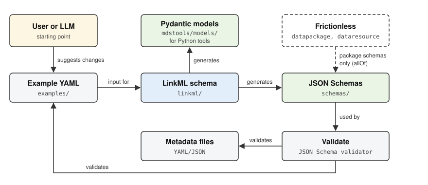

# Schema Generation



The schemas are written in [LinkML](https://linkml.io/) because a single definition gives several outputs: the JSON Schemas in `schemas/`, the Pydantic models in `mdstools/models/`, and the schema reference pages of this documentation. The JSON Schemas and the Pydantic models are generated separately from the LinkML files and are never edited by hand. A schema change usually starts with an edited example in `examples/`, which shows how the metadata should look and is validated once the schema is updated.

## Data packages and Frictionless

The package schemas `echemdb_package` and `svgdigitizer_package` build on the [Frictionless Data Package](https://datapackage.org/) standard. Each entry in `resources` must be valid against both the Frictionless data resource schema (fields such as `name`, `path` and `format`) and the echemdb resource definition, which adds the `metadata` property. The generated JSON Schemas express this with `allOf` and refer to the Frictionless schema by its URL (`https://datapackage.org/profiles/2.0/dataresource.json`), so any JSON Schema validator can resolve it. Within this repository, `pixi run validate` and the schema enrichment use a copy of the Frictionless schemas that is downloaded on first use into `schemas/frictionless/` (not part of the repository).

## Commands

Schemas are generated from LinkML YAML definitions:

```bash
# Generate JSON Schemas
pixi run generate-schemas

# Generate Pydantic models
pixi run generate-models

# Generate both
pixi run generate-all
```

Validate the example files against the schemas:

```bash
pixi run validate
```
