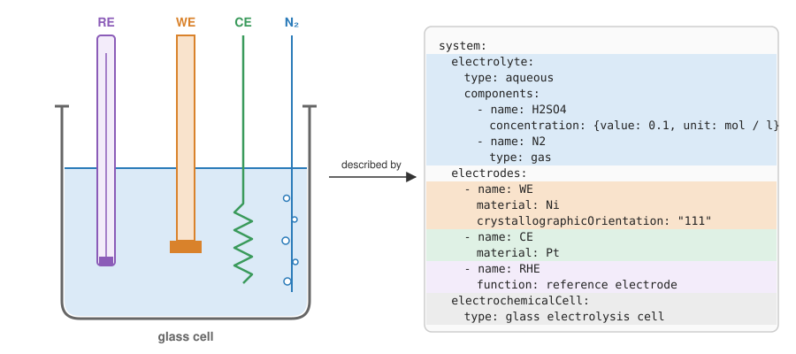

# echemdb metadata-schema

The [metadata-schema](https://github.com/echemdb/metadata-schema) repository provides standardized metadata schemas to describe electrochemical systems and the collected data. The `mdstools` Python package allows generating, validating and working with them.
This project is part of the [echemdb](https://www.echemdb.org) community project.



::::{grid} 1 1 2 2
:gutter: 3

:::{grid-item-card} Electrochemistry metadata
Schemas for describing electrochemical data: electrodes, electrolytes, cells, the experimental setup, the data source and its curation.

- [Schema reference](schemas.md)
- [Example files](examples.md)
- {ref}`JSON Schema downloads <json-schemas>`

:::

:::{grid-item-card} Tools
How the schemas are generated from LinkML, and how to flatten, enrich, validate and migrate metadata with `mdstools`.

- [Installation](installation.md)
- [Usage](usage.md)
- [Schema generation](generation.md)
- [API reference](api.md)

:::

::::

(json-schemas)=
## JSON Schemas (v0.8.4)

The following JSON Schema files can be used to validate metadata in any language or tool that supports JSON Schema:

| Schema | Download |
| --- | --- |
| Autotag | [autotag.json](https://raw.githubusercontent.com/echemdb/metadata-schema/0.8.4/schemas/autotag.json) |
| Minimum echemdb | [minimum_echemdb.json](https://raw.githubusercontent.com/echemdb/metadata-schema/0.8.4/schemas/minimum_echemdb.json) |
| Source Data | [source_data.json](https://raw.githubusercontent.com/echemdb/metadata-schema/0.8.4/schemas/source_data.json) |
| SVG Digitizer | [svgdigitizer.json](https://raw.githubusercontent.com/echemdb/metadata-schema/0.8.4/schemas/svgdigitizer.json) |
| echemdb Package | [echemdb_package.json](https://raw.githubusercontent.com/echemdb/metadata-schema/0.8.4/schemas/echemdb_package.json) |
| SVG Digitizer Package | [svgdigitizer_package.json](https://raw.githubusercontent.com/echemdb/metadata-schema/0.8.4/schemas/svgdigitizer_package.json) |

```{toctree}
:caption: Electrochemistry metadata
:maxdepth: 2
:hidden:

schemas
examples
```

```{toctree}
:caption: Tools
:maxdepth: 2
:hidden:

installation
usage
generation
api
```
