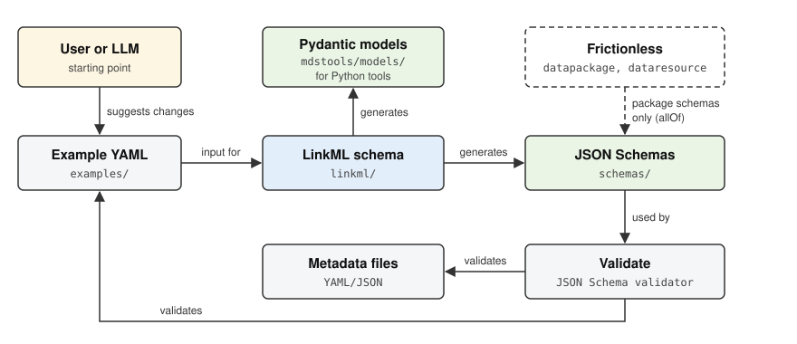

# Schema Reference

All metadata schemas are defined as [LinkML](https://linkml.io/) YAML files and serve as the single source of truth. From these definitions, JSON Schema files and Pydantic models are generated automatically.

## Available schemas

The following schema types are available:

::::{grid} 2
:gutter: 3

:::{grid-item-card} Autotag
:link: schema/autotag/index
:link-type: doc
Complete metadata for YAML templates used by [autotag-metadata](https://echemdb.github.io/autotag-metadata/).
:::

:::{grid-item-card} Minimum echemdb
:link: schema/minimum_echemdb/index
:link-type: doc
Minimum set of metadata required for the echemdb database.
:::

:::{grid-item-card} Source Data
:link: schema/source_data/index
:link-type: doc
Source data with data description (dialect, field mapping, field units).
:::

:::{grid-item-card} SVG Digitizer
:link: schema/svgdigitizer/index
:link-type: doc
Metadata for digitized data from SVG figures.
:::

:::{grid-item-card} echemdb Package
:link: schema/echemdb_package/index
:link-type: doc
Data package schema for echemdb, composing with the Frictionless Data Package standard.
:::

:::{grid-item-card} SVG Digitizer Package
:link: schema/svgdigitizer_package/index
:link-type: doc
Data package schema for SVG Digitizer output.
:::

::::

## Schema generation



The schemas are written in LinkML because a single definition gives several outputs: the JSON Schemas in `schemas/`, the Pydantic models in `mdstools/models/`, and the schema reference pages of this documentation. The JSON Schemas and the Pydantic models are generated separately from the LinkML files and are never edited by hand. A schema change usually starts with an edited example in `examples/`, which shows how the metadata should look and is validated once the schema is updated.

### Data packages and Frictionless

The package schemas `echemdb_package` and `svgdigitizer_package` build on the [Frictionless Data Package](https://datapackage.org/) standard. Each entry in `resources` must be valid against both the Frictionless data resource schema (fields such as `name`, `path` and `format`) and the echemdb resource definition, which adds the `metadata` property. The generated JSON Schemas express this with `allOf` and refer to the Frictionless schema by its URL (`https://datapackage.org/profiles/2.0/dataresource.json`), so any JSON Schema validator can resolve it. Within this repository, `pixi run validate` and the schema enrichment use a copy of the Frictionless schemas that is downloaded on first use into `schemas/frictionless/` (not part of the repository).

### Commands

Schemas are generated from LinkML YAML definitions:

```bash
# Generate JSON Schemas
pixi run generate-schemas

# Generate Pydantic models
pixi run generate-models

# Generate both
pixi run generate-all
```

## Validation

Validate example files against the schemas:

```bash
pixi run validate
```

## Schema details

```{toctree}
:maxdepth: 2

schema/autotag/index
schema/minimum_echemdb/index
schema/source_data/index
schema/svgdigitizer/index
schema/echemdb_package/index
schema/svgdigitizer_package/index
```

```bash
pixi run validate
```
