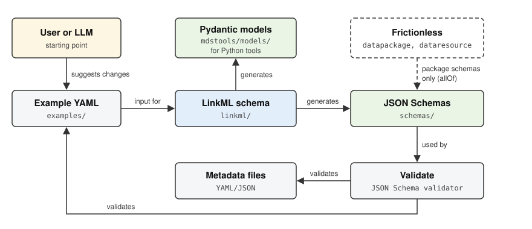

# Tools



The `mdstools` Python package generates the schemas from LinkML and works with metadata files: it flattens them to Excel or CSV, enriches them with descriptions and examples from the schemas, validates them, and migrates them to newer schema versions.

- [Installation](installation.md): set up `mdstools` with pixi or pip.
- [Usage](usage.md): the command-line interface and the Python API.
- [Schema generation](generation.md): how the JSON Schemas and Pydantic models are generated from LinkML.
- [API reference](api.md): the `mdstools` modules.

```{toctree}
:maxdepth: 2

installation
usage
generation
api
```
